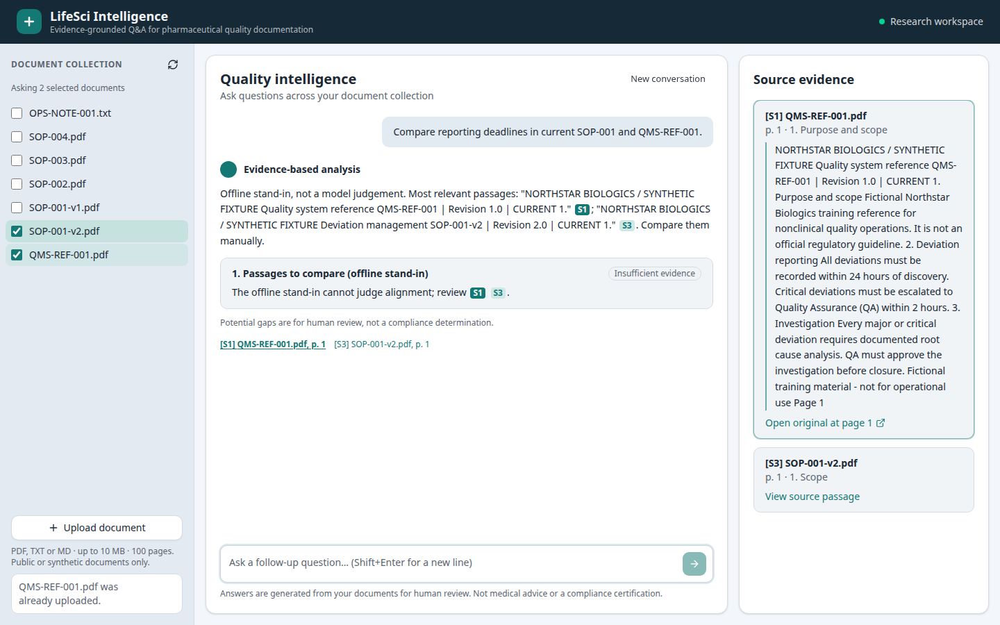

# LifeSci Intelligence

Evidence-grounded document intelligence for pharmaceutical quality and regulatory documentation.
Upload SOPs and reference guidance as PDF or text, ask questions in plain language and get answers backed by clickable citations to the exact source passages. When the documents do not support an answer, the assistant says so instead of guessing. A bounded comparison agent checks procedures against reference guidance and reports supported points, potential gaps and missing evidence for human review.

## Intended experience
Upload public or synthetic PDF/text documents, ask questions, inspect exact source passages and compare procedures against reference guidance. Findings are potential gaps for human review, not clinical advice or compliance certification.




*The app running end to end on the seeded synthetic corpus, captured by the Playwright smoke test (`E2E_SCREENSHOT_DIR`). Top: golden question E01 scoped to SOP-001-v2. Retrieval returns the passage containing the 48-hour recording rule, and the citation opens it in the evidence panel. Bottom: golden comparison E06 with two documents selected. The bounded agent searches both documents, returns a structured finding with citations to QMS-REF-001 (24 hours) and SOP-001-v2 (48 hours), and the evidence panel shows the exact source passages.*

## Documentation
| Topic | Document |
|---|---|
| Architecture, data model, request flows | [docs/architecture.md](docs/architecture.md) |
| Agent runtime architecture and execution controls | [docs/agent-runtime-architecture-and-execution-controls.md](docs/agent-runtime-architecture-and-execution-controls.md) |
| Decisions and trade-offs | [docs/adr/](docs/adr/) (0001–0008) |
| Engineering standards followed and skipped | [docs/engineering-standards.md](docs/engineering-standards.md) |
| Security controls and known gaps | [docs/security.md](docs/security.md) |
| Productionization plan (not implemented) | [docs/productionization.md](docs/productionization.md) |
| Test corpus, checks, evaluation method and results | [evals/README.md](evals/README.md) |
| AI-assisted development workflow | [docs/ai-workflow.md](docs/ai-workflow.md) |
| Key technical and product decisions | [docs/key-technical-and-product-decisions.md](docs/key-technical-and-product-decisions.md) |
| AI-generated suggestions I challenged | [docs/examples-of-ai-generated-suggestions-i-challenged.md](docs/examples-of-ai-generated-suggestions-i-challenged.md) |

## Releases

### v2 (2026-11-25)
- **Live deployment:** frontend on Vercel, API on Render. Live app: https://lifesci-intelligence.vercel.app
- **Google Gemini support:** `MODEL_PROVIDER=gemini` with `GEMINI_API_KEY`. Chat uses `GEMINI_MODEL` (default `gemini-flash-lite-latest`) through `generateContent` with structured JSON output; embeddings use `gemini-embedding-001` at 1536 dimensions, so the database schema is unchanged. OpenAI and the offline provider still work.
- **Sample documents ship with the frontend:** the synthetic corpus is bundled under `frontend/public/samples/`, and **Load sample documents** in the sidebar loads it in one click, including document versions.
- **Upload API:** `POST /api/documents` accepts an optional `version` field.

### v1
Initial MVP: PDF/text upload, page-aware chunking, hybrid retrieval, grounded answers with clickable citations and abstention, the bounded comparison agent, evaluation harness, Docker Compose setup and CI.

## Local setup
Prerequisites: Docker with Compose v2. For running checks outside containers: uv (Python 3.12) and Node 24 / npm.

```bash
cp .env.example .env          # optional; defaults work without it (MODEL_PROVIDER=fake, no key needed)
docker compose up --build --wait
curl http://127.0.0.1:8000/health/ready   # {"status":"ok","database":"ok"}
```

Web UI: http://127.0.0.1:3000 · API: http://127.0.0.1:8000 (docs at `/docs`) · Postgres: 127.0.0.1:5432. All ports bind to loopback only. The API applies Alembic migrations on startup.

**Live model:** set `MODEL_PROVIDER=openai`, `OPENAI_API_KEY` and `OPENAI_CHAT_MODEL` in `.env`, or `MODEL_PROVIDER=gemini` and `GEMINI_API_KEY` (optional `GEMINI_MODEL`, default `gemini-flash-lite-latest`; embeddings use `gemini-embedding-001` truncated to 1536 dimensions), then reset and reseed. Embeddings from different providers must not be mixed in one database. The Gemini adapter calls the REST API (`models/{model}:generateContent` with `responseJsonSchema`) and is covered by mocked-HTTP unit tests; a live Gemini run has not been recorded.

**Reset:** `docker compose down -v && docker compose up --wait && docker compose exec api python -m app.seed`. The `-v` deletes the database and document-storage volumes, so all uploads and conversations are lost.

*Verified 2026-11-24 from a fresh clone at commit `0710cc0`:* a separate Compose project started healthy in about 20 s, the seed ingested 7 of 7 documents, the four Playwright smoke tests passed, and after `down -v` the library was empty and reseeding restored it.

**Sample documents in the UI:** the frontend bundles the synthetic samples in `frontend/public/samples/` (served at `/samples/`, so they ship with any frontend deployment, e.g. Vercel). **Load sample documents** in the sidebar uploads them through the normal API; files already present are skipped by hash. Each sample is uploaded with its manifest `version` (optional `version` form field on `POST /api/documents`; an existing duplicate keeps its stored version). After changing `lifesci-test-data/`, run `npm run samples:sync` in `frontend/`; a unit test fails if the bundle drifts from the manifest.

Test corpus, seeding, test commands and evaluations: [evals/README.md](evals/README.md).

## Architecture
Next.js + shadcn/ui -> FastAPI -> LangGraph chat graph (rule routing; grounded Q&A or a bounded read-only tool agent for comparisons) -> retrieval, ingestion and model adapters -> PostgreSQL + pgvector and server file storage. Hybrid full-text/vector retrieval fused with RRF. Optional metadata-only LangSmith tracing. Details: [docs/architecture.md](docs/architecture.md); also the [plan](mvp-implementation-plan.md), [roadmap](development-roadmap.md) and [product design](docs/product-design.md).

## Productionization
Not production-ready: a single-user demo, publicly deployed without authentication. The proposed path is in [docs/productionization.md](docs/productionization.md): OIDC with RBAC and row-level tenant isolation, ECS Fargate, RDS pgvector, S3 with KMS, Secrets Manager, queued ingestion, eval-gated model changes, monitoring, backups and incident runbooks. Security controls and gaps: [docs/security.md](docs/security.md). No patient data or confidential documents.

## AI-assisted development and decisions
How AI was used in development, quality guardrails and review findings: [docs/ai-workflow.md](docs/ai-workflow.md). Key technical and product decisions: [docs/key-technical-and-product-decisions.md](docs/key-technical-and-product-decisions.md). Examples of AI-generated suggestions I challenged: [docs/examples-of-ai-generated-suggestions-i-challenged.md](docs/examples-of-ai-generated-suggestions-i-challenged.md).

## What I would do differently with more time

Given the time constraints, I prioritized a working end-to-end document intelligence workflow over a comprehensive production platform. With more time, I would focus on improving the quality of the evidence, validating architectural assumptions and making the application ready for real customer workloads. I would not necessarily introduce more technologies or agents.

Known limitations of the current build are listed under the area where I would address them. The most important one: answer quality, gap detection, latency and cost have not yet been measured systematically across models.

### 1. Validate the product with domain experts

I would involve quality assurance and regulatory affairs professionals earlier in the development process. I would observe how they search documentation, compare procedures and investigate discrepancies, then use their feedback to refine the workflows and acceptance criteria.

I would replace or supplement the synthetic document collection with representative, appropriately authorized and anonymized documents. I would also validate the terminology and interpretation of regulatory requirements with subject matter experts rather than relying on the LLM's general knowledge.

### 2. Expand the evaluation framework

**Current state:** 16 golden cases. The section matching used to score retrieval is heuristic.

I would build a larger, independently reviewed golden dataset covering ambiguous questions, conflicting evidence, superseded documents, numerical thresholds, multi-document reasoning and adversarial inputs.

I would measure retrieval recall and ranking quality separately from answer correctness, grounding, citation accuracy and abstention behavior. I would compare vector-only retrieval, keyword search, hybrid retrieval and reranking against the same dataset, recording latency and cost alongside quality metrics.

I would use LangSmith for experiment comparison and trace analysis, while retaining deterministic local tests and introducing regression gates in CI. My objective would be to make changes to prompts, models and retrieval strategies evidence-driven rather than subjective.

### 3. Improve document ingestion and retrieval

**Current state:** text-based PDF, TXT and MD only, with no OCR or table extraction. Ingestion is synchronous and capped at 10 MB and 100 pages. Retrieval uses exact vector search, which is fine at demo scale.

I would investigate layout-aware parsing, OCR for scanned documents, table extraction and section-aware chunking. Pharmaceutical documents often contain structured tables, cross-references and revision histories that can lose meaning when converted into plain text.

I would introduce explicit document lifecycle management, including version history, effective dates, superseded status, ingestion provenance and reindexing. I would also evaluate metadata filtering and reranking before adopting them as default retrieval strategies.

For larger workloads, I would move ingestion into an asynchronous, idempotent processing pipeline with persistent job status, bounded retries and failure recovery. I would retain PostgreSQL and pgvector until measured workload characteristics justified a different storage or search architecture.

### 4. Strengthen agent reliability and execution control

**Current state:** comparison routing is a wording rule, so implicit comparisons need `mode=compare`. Findings are for human review, never a compliance determination.

I would expand the evaluation of the LangGraph workflows to determine when iterative retrieval and multi-step reasoning provide measurable value over a simpler RAG pipeline.

I would strengthen application-level enforcement of execution deadlines, LLM and tool call limits, token budgets and financial budgets. For concurrent requests, I would introduce atomic budget reservations and persistent usage accounting to prevent multiple executions from exceeding shared quotas.

I would test failure scenarios such as provider throttling, timeouts, malformed model outputs, insufficient evidence and partial execution failures. I would make termination reasons explicit and ensure that the application can abstain safely rather than generate unsupported findings.

### 5. Strengthen security and data governance

**Current state:** a single-user demo with no authentication, encryption at rest or rate limiting. The prompt-injection guard is heuristic (see [docs/security.md](docs/security.md)).

Before introducing real customer documents, I would implement authentication, tenant isolation and document-level authorization. Access restrictions would be enforced during retrieval and source access, independently of the model.

I would strengthen file validation, indirect prompt injection defenses, tool permissions, secrets management, encryption, audit logging and data retention policies. I would also review what document content and metadata are sent to external model and observability providers.

For a regulated life sciences environment, I would work with security, privacy and quality stakeholders to establish the applicable requirements, validation procedures and change controls. I would not present the application as a validated regulatory compliance system without the necessary evidence and approvals.

### 6. Improve production readiness and operational ownership

**Current state:** deployed as a single-instance demo with the frontend on Vercel and the API on Render (https://lifesci-intelligence.vercel.app); Docker Compose is used for development. The repository has no infrastructure as code or separate staging environment.

I would establish service-level objectives for availability, latency and reliability, supported by load testing and operational metrics. I would monitor retrieval latency, model latency, token consumption, cost, error rates, ingestion failures and budget exhaustion.

I would introduce deployment pipelines with automated quality gates, infrastructure as code, environment separation, database migration procedures and rollback mechanisms. I would also establish alerting, incident response runbooks, backup and restore testing and clear ownership of production support.

For a production deployment, I would evaluate managed container services, PostgreSQL and object storage before considering more complex infrastructure. I would introduce distributed rate limiting and concurrency controls when scaling beyond a single backend instance.

### 7. Improve the user experience and integrations

**Current state:** comparison findings are not saved with the conversation. Streaming (SSE), exports, a dashboard, a version-aware comparison UI and FastMCP tools are not built.

I would refine the evidence viewer to make it easier to navigate directly to relevant document passages, compare conflicting requirements and understand which document version supports a finding.

I would explore streaming responses, persistent conversation history, structured comparison reports and user feedback mechanisms. I would also consider MCP integration to expose selected document intelligence capabilities to authorized external AI clients, provided there is a concrete integration requirement.

I would prioritize features based on observed user workflows rather than adding capabilities simply because they are technically possible.

### 8. Improve the AI-assisted development process

I would extend the repository's AI development instructions, reusable skills and review workflows based on recurring implementation mistakes. I would introduce more automated verification of AI-generated changes, particularly around authorization, retrieval correctness and agent execution boundaries.

I would also maintain a lightweight record of architectural decisions and significant AI-generated recommendations that I accepted, rejected or modified, including the reasoning and verification behind those decisions.

### My priorities

| Priority | Focus | Expected benefit |
|---|---|---|
| P0 | Domain expert feedback and stronger evaluations | Validate product value and answer reliability |
| P0 | Security, authorization and data governance | Enable responsible use of customer documents |
| P1 | Document parsing, versioning and retrieval improvements | Improve evidence quality and traceability |
| P1 | Agent reliability, resource budgets and failure handling | Predictable execution and cost |
| P1 | Deployment, observability and operational processes | Sustainable production ownership |
| P2 | UX enhancements and external integrations | Improve adoption and workflow efficiency |

My main takeaway is that a successful prototype demonstrates feasibility, but a production-grade AI application must also demonstrate reliability, security, measurable quality and operational sustainability. With more time, I would prioritize collecting evidence that the system meets those expectations rather than increasing architectural complexity without a demonstrated need.

