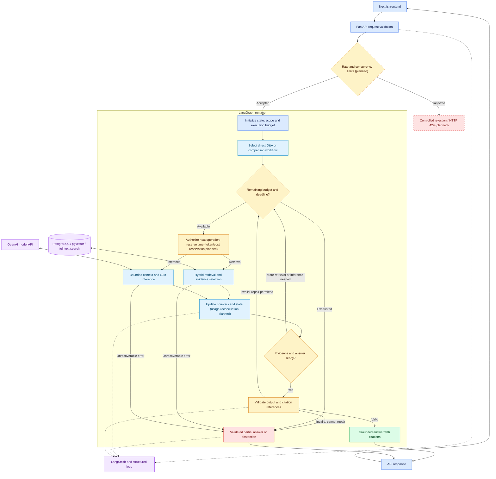

# Agent Runtime Architecture and Execution Controls

## High-level agent runtime

I designed the agent runtime around a controlled, stateful LangGraph workflow rather than an unrestricted autonomous agent. My objective is to combine grounded document retrieval with bounded reasoning, predictable resource consumption and traceable answers.

The Next.js frontend submits a question to the FastAPI backend. The backend validates the request and initializes an execution state containing the question, document scope, accumulated evidence, step and search counters and execution deadline. Admission and concurrency controls (rate limits, HTTP 429) are *planned production design* and are not implemented in the MVP.

For straightforward questions, I favor a direct retrieval and generation path. For more complex tasks, such as cross-document comparison, the workflow can perform additional retrieval iterations when the available evidence is insufficient.

I use PostgreSQL with pgvector and full-text search for hybrid retrieval. Retrieved evidence is ranked, deduplicated and assembled within a bounded context window. The LLM interprets the evidence and proposes an answer or a further retrieval action, but application code controls which actions are permitted.

Before each LLM or tool invocation, the runtime checks the remaining step, search and time budget, and holds back time for the steps that must follow (for example, final synthesis). Reserving estimated token and cost budget before each call and reconciling it with actual consumption afterwards is *planned production design*: the MVP logs token counts per provider call (`model_usage`) but does not accumulate them into a per-request budget. The workflow terminates when sufficient evidence is available, a limit is reached or an unrecoverable error occurs.

Before returning an answer, the backend validates its structure and verifies that citation identifiers refer to retrieved evidence within the permitted document scope. Citation validation establishes traceability, not proof that every generated claim is correct; grounding quality is also assessed through evaluations. If evidence is insufficient, the runtime should abstain or return a clearly identified, validated partial answer rather than inventing findings.

## Agent execution flow

I keep observability separate from enforcement. LangSmith and structured logs provide visibility into execution traces, retrieval behavior, latency and termination reasons (per-call token counts are logged; per-request accounting is planned), while the runtime itself owns all execution limits. Tracing should be optional and configured to avoid exposing sensitive document content.

The diagram describes the intended runtime architecture; nodes marked *planned* (dashed outline for admission control) are not implemented in the MVP. Direct question answering can use a simplified path through the same controls; additional iterations are reserved for tasks that benefit from them.

### Agent execution limits, rate limiting and budget control

I consider resource consumption and execution control fundamental requirements for agentic applications.

Unlike a conventional request-response application, an agentic workflow can dynamically execute multiple LLM calls, retrieval operations and tool invocations. Without explicit boundaries, this can lead to unpredictable latency, excessive token consumption, unnecessary API costs and potentially unbounded execution loops.

My approach is to enforce resource limits at multiple levels: incoming API requests, concurrent executions, agent steps, LLM calls, tool invocations, context size, output tokens, retries and total execution time.

| Control | MVP status |
|---|---|
| Agent steps and tool searches per request | Implemented (`AGENT_MAX_STEPS=6`, `AGENT_MAX_SEARCHES=3`) |
| Context size and output tokens | Implemented (6,000-token context budget, 1,000 output tokens) |
| Conversation history | Implemented (last 6 messages, 2,000 characters each) |
| Per-call token logging | Implemented (`model_usage` log: token counts only, never text; not yet exercised live) |
| Total execution time | Implemented (45-second request deadline; time held back for later steps) |
| Provider timeouts and retries | Implemented (30-second timeout, 2 retries) |
| Incoming request rate limits and concurrent executions | Planned production design |
| Token and cost budget with reservation and reconciliation | Planned production design (per-call token counts are logged, not yet budgeted) |

I also consider financial cost an explicit execution budget rather than simply an operational metric. In the planned production design, the application tracks cumulative resource consumption and verifies that sufficient budget remains before initiating additional operations.

These controls belong to the application layer and should not depend on the LLM following instructions. The model can propose actions, but the application remains responsible for authorizing and executing them within predefined boundaries.

I prefer to use LangSmith for tracing, monitoring and analyzing resource consumption while keeping budget enforcement independent of the observability platform.

For the MVP, I favor simple, configurable application-level controls rather than introducing distributed rate-limiting infrastructure prematurely. In a production environment, I would extend this approach with distributed rate limiting, persistent usage accounting, tenant-level quotas, cost alerts and centralized budget management.

My objective is to make agentic behavior not only functional but also predictable, measurable and economically sustainable.
