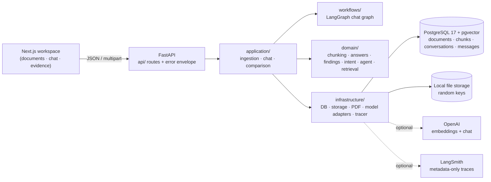

# Architecture

This document describes what is implemented as of Phase 4. The decision records in `docs/adr/` explain why each choice was made.

## System

- **Runtime:** Docker Compose runs `db`, `api` and `web`, with every port bound to 127.0.0.1. The API applies Alembic migrations on start.
- **Model providers:** `MODEL_PROVIDER=fake` (the default) uses deterministic offline stand-ins: hashed bag-of-words embeddings and an extractive "model". `MODEL_PROVIDER=openai` uses `text-embedding-3-small` (1536 dimensions) and a configurable chat model.
- **Layering:** the domain layer has no framework or vendor imports. Providers, the tracer and the clock are injected, so tests swap in fakes.

## Data model

| Table | Key columns |
|---|---|
| `documents` | id, name, sha256 (unique: duplicates are detected), media_type, version, storage_key (random), status `processing\|ready\|failed`, error, created_at |
| `chunks` | id, document_id, ordinal, page (1-based; null for text), section, text, embedding `vector(1536)`, search `tsvector` (GIN index) |
| `conversations` / `messages` | role, content, citations JSON, identity `seq` for deterministic ordering |

Only `ready` documents are retrievable. Vector search is exact cosine (no ANN index yet, by design: ADR 0006).

## Flows

**Upload (synchronous, bounded):**
1. Validate the extension, file signature, size (10 MB), page count (100), and that the text is extractable. Encrypted and scanned PDFs are rejected.
2. Store the file under a random key and split it into page-aware chunks of about 500 tokens with 80 tokens of overlap.
3. Embed the chunks in batches, then commit the chunks and the `ready` status in one transaction. On failure the document is `failed` and has no chunks (ADR 0001, 0002).

**Chat (`POST /api/chat`):** the request deadline is 45 s and history is bounded (ADR 0005). It runs the LangGraph graph `route → answer_qa | plan ⇄ act → synthesize` (ADR 0008).
- **route:** a deterministic rule. `mode=qa|compare` is honoured. `auto` picks compare for comparison wording when two or more ready documents are in scope.
- **answer_qa:**
  1. Hybrid retrieval: vector and full-text pools of 20 each, fused with RRF (k=60), top 8 (ADR 0006).
  2. The context budget is 6000 tokens. Sources are fenced as untrusted data and given labels S1….
  3. The model returns structured output. Citations are validated against the allowlisted labels, with one repair attempt, then abstention (ADR 0003).
- **plan ⇄ act (comparison):**
  - Each step, the model picks one read-only tool through structured output: `list_documents`, `search` (optionally restricted to one document), `read_passage` or `finish`.
  - Arguments are checked against allowlists.
  - Budgets: 6 steps, 3 searches, 4 results per search, the context-token cap, and 10 s of the deadline reserved for the answer.
- **synthesize:** structured findings, each `supported`, `potential_gap` or `insufficient_evidence`. A supported or potential-gap finding must cite at least two documents. One repair attempt, then abstention.
- **Citations everywhere:** quotes, pages and document IDs are taken from the database, never from model text.

**Evidence:** `GET /api/documents/{id}/chunks/{chunk_id}` returns the exact passage. `GET /api/documents/{id}/file` serves the original file inline (`nosniff`, and CSP `sandbox` for text files).

## Quality and operations
- **Tests:** unit (pure domain), integration (real pgvector with fake providers), security fixtures, the offline eval harness, and Playwright browser smoke. They run in CI on every push and pull request (`.github/workflows/ci.yml`).
- **Logs:** structured JSON with a request ID, durations, token counts, statuses and error classes. Document text, questions and answers are never logged (ADR 0007).
- **Tracing:** optional LangSmith tracing (`TRACE_LANGSMITH`) sends metadata only by default. LangChain auto-tracing is forced off.
- **Evaluations:** `backend/app/evaluation/run.py` compares vector and hybrid retrieval and runs a comparison-agent pass. Reports are in `evals/reports/`; only offline runs exist.

## Not implemented
Authentication and RBAC, multi-tenancy, durable ingestion jobs, OCR, SSE streaming, FastMCP, cloud deployment, exports and dashboards. See `docs/productionization.md` and the roadmap's Phase 5.
